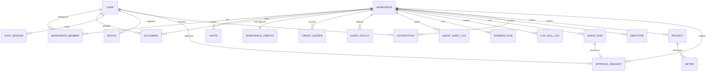

<!-- Sliced from the originating product's shared spec file, keeping only
     audit content. Commit lineage is the original file's; see
     PROVENANCE.md. Generated by notifslice.py -- do not hand-edit. -->

### Note (P) — a Document with `source_type='note'`

- A bare URL with no body creates a note whose draft body is the page summary, under the same accept gate.

### Credit Balance & Ledger (P)

- Rules: append-only; Redis balance = `SUM(ledger.delta) + grants`; rehydrate-on-cold-start + hourly reconciliation (research §3). The **Go kernel billing worker is the sole `credit_ledger` writer** (`backend-go/kernel/billing/`); Python spend producers only publish `billing.deduct` events and never write the ledger.

### AI Operation Record / LLM Call Log (P)

- No raw message bodies (FR-024). Drives `llm_cost_daily` materialized view (admin dashboard, FR-022).

### Agent Policy (P)

- `agent_policies`: `id`, `workspace_id`, `agent_role` (`user`|`admin`|`automation`|`integration`), `allowed_tools[]` (MCP tool names), `token_budget_day` INT, `max_loop_depth` INT (default 20), **`run_deadline_s` INT (default 1800)**, **`max_steps` INT (default 60)**, `hooks_enabled[]` (`audit`|`langfuse`|`garak`), **`can_write` BOOL (default false)**, **`write_ops[]`** (Phase 1: only `note_update`), **`write_max_level` INT** (upper bound on an agent write's access level, ≤ owner clearance), `created_at`

### Audit Record (P + K)

- `agent_audit_log` (P): `id`, `workspace_id`, `user_id`, `agent_role`, `tool_called`, `token_cost`, `result_hash` (tamper-evident result fingerprint), `trace_id`, `created_at`, **`seq` BIGINT + `prev_hash` + `entry_hash` (per-tenant tamper-evident chain link)**. Partitioned by `created_at`.
- `audit_log` (K): generic workspace/member actions — `id`, `workspace_id`, `actor_type`, `actor_id`, `action`, `resource_type`, `resource_id`, `metadata` JSONB, `created_at`, **`seq` BIGINT + `prev_hash` + `entry_hash` (per-tenant tamper-evident chain link)**. Partitioned by `created_at`.
- Rules: append-only; AI tool calls and workspace/member actions both audited (FR-023).
- **Tamper-evidence (chain, not just per-row hash).** Beyond the standalone `result_hash` (a fingerprint of a *result body* that is **not** stored, FR-024), each row carries a monotonic per-tenant **`seq`** and links the previous row via **`prev_hash`** → **`entry_hash` = H(prev_hash ‖ canonical(entry) ‖ seq)**, so a deleted/edited/reordered row breaks the chain (a `seq` gap or hash mismatch). The per-tenant chain head is authoritative Redis state at **`audit:head:{kind}:{tenant}`**, advanced atomically on each append. This upgrades the per-row fingerprint into a verifiable history **without changing what content is stored** (still refs + hashes only, never bodies). `sandbox_run` (below) is the same shape with the same chain columns.
- **Reusability seam**: `audit_log` + `agent_audit_log` (+ `sandbox_run`) are the durable backing of the domain-agnostic `Recorder`/`Sink`/`HashChain`/`AuditQuery` ports — `workspace_id` is the opaque `Tenant`, `actor_type`/`agent_role` fold into one `Actor{Kind,ID,Role}` (a member action is `Kind:"user"`, an AI tool call `Kind:"agent"`, a sandbox run `Kind:"sandbox"`), `action`/`tool_called` become a registered `Action`, and the `Sink` is `PostgresSink` over these partitions. Adding an audited surface is a new `Actor.Kind`/`Action` value, **not** a new table; a second durable target (SIEM/Kafka/S3) is a registered `Sink`, not an edit to the write path. See [contracts/audit-ports.md](./contracts/audit-ports.md).

### Sandbox Run Record (P)

- `sandbox_run` (P): `id`, `workspace_id`, `user_id`, `template` (`tmpl-crawl`|`tmpl-convert`|`tmpl-coderun`), `feature` (`ingest.crawl`|`ingest.convert`|`agent.run_script`), `exit_code` INT, `vcpu_seconds` INT, `wall_ms` INT, `egress_bytes` BIGINT, `timed_out` BOOL, `result_hash` (tamper-evident result fingerprint), `trace_id`, `created_at`, **`seq` BIGINT + `prev_hash` + `entry_hash` (per-tenant tamper-evident chain link)**. Partitioned by `created_at`.
- Rules: append-only; **exactly one row per sandbox execution** (contract-test obligation). Compute is metered by publishing `billing.deduct.<ws>` with `operation_type ∈ {sandbox.crawl, sandbox.convert, sandbox.run_script}` — the **Go kernel billing worker stays the sole `credit_ledger` writer** (SC-006); the Python sandbox client only writes this audit row and emits the spend event. **No file contents or generated-code bodies are stored** here (only `result_hash`), matching the `llm_call_log` no-body rule (FR-024). A sandbox holds no ambient credentials and no DB/Qdrant access; results re-enter the index only through the normal pipeline / HITL accept gate, so this record cannot widen access (SC-001, research §24).

### Approval Request (K)

- Rules: RLS restricts rows to `user_id = current_setting('app.user_id')::uuid` within `workspace_id` — a gate is visible/resolvable only by its approver, never another member or across workspaces even at L5 (FR-040, SC-014, parity with SC-012). **Fail-closed**: a `pending` gate never lets its action proceed; a scheduled sweep (`approval.expire.tick`) flips overdue `pending`→`expired`. Resolving is idempotent (first decision wins). The `decision` is **human-authored, never derived from model/tool/document output** (research §5, FR-011). **Zero credits** are spent and **no subject side effect** occurs while `pending` (refuse-before-spend, parity with the `guard` node). Every resolution writes an `audit_log` row (FR-023).

### Notifications (K)

- Rules: RLS restricts `notifications` to `user_id = current_user` within `workspace_id` — a notification is never visible to any other member or across workspaces, even at L5 (FR-036, SC-012). The notification service applies `notification_preferences` before delivery; an absent preference row uses the category default (in-app on; email on for `credit_warning`, `credit_exhausted`, `invite_received`, `task_halted`, `approval_requested`, off otherwise — `approval_requested` defaults email-on because a paused agent action is actionable and time-sensitive) (FR-035). Delivery is idempotent: the persist step writes the `notifications` row **and one `notification_outbox` row per enabled channel in a single transaction**, so a redelivered/retried event is a no-op via the `(user_id, idem_key)` unique constraint (one row, one delivery per channel). The `SET NX notify:applied:{idem_key}` guard is only a fast pre-check that gates the durable write — **never** channel delivery, which is driven off the durable outbox at-least-once (each channel idempotent on `idem_key`) so a crash between persist and send cannot silently drop an email (FR-032, SC-013; [notification-ports.md](./contracts/notification-ports.md), invariants 3–4). High-volume same-category bursts for one recipient are coalesced into a digest/rate-limited summary rather than one push + one email per event (FR-038). The email worker skips any address present in `email_suppressions` and adds rows on provider bounce/complaint webhooks; unsubscribe links flip the relevant `notification_preferences.email` to false (FR-035). Retention: read notifications older than a configured window (default 90 days) are pruned/archived so inbox + unread-count stay performant; the table MAY be range-partitioned by `created_at` for cheap drop (FR-039). Index on `(user_id, read_at, created_at)` for inbox + unread-count queries.

### Billing & payments (Phase 2, US4-ext)

- `payment_events` (K) — verified provider webhook dedup + audit (`UNIQUE (provider, provider_event_id)`, AP4).

### Document Versioning (Phase 2 — agent file edits)

Needed by the agent `transform_files` tool: an approved run **replaces the document's current
content in place and retains the prior bytes as a version**. Append-only — a version row's
`s3_key` is never overwritten or deleted, which is the entire reason this shape was chosen
over an artifact-only write-back.

- `document_versions` (P): `id`, `workspace_id` (RLS), `document_id` FK, `version_no` INT,
  `s3_key`, `content_hash`, `byte_size`, `created_via` (`member_upload`|`agent_edit`),
  `created_by_user_id`, `agent_run_id` FK NULL, `sandbox_run_id` FK NULL,
  `approval_request_id` FK NULL, `created_at`. `UNIQUE (document_id, version_no)`.
- `documents.current_version_no` INT — the pointer; `documents.s3_key` always resolves to the
  current version's object.

Five rules, each load-bearing:

1. **Accountability lands on a human, not the agent.** On an `agent_edit`, `created_by_user_id`
   is the **approving member** — never the agent or its owner-by-default. This is what keeps
   FR-004's principle intact: a document's content still changes only through an authenticated
   human context, with `agent_run_id` / `sandbox_run_id` recording *how* it was produced.
2. **`access_level` never changes on an agent edit.** The `WriteEnvelope` floor that governs
   `edit_note` applies unchanged — an agent may not raise a document's access level, and edits
   are bounded by `min(agent, owner)` clearance.
3. **Re-index REPLACES, it does not append.** On commit, the prior version's Qdrant points and
   `chunks` rows are deleted and the new version is ingested (convert → chunk → embed) in the
   same idempotent unit, keyed by `document_version.id`. Getting this wrong is silent and
   corrupting: appending leaves stale chunks answering queries from content that no longer
   exists, and a partial delete leaves a document unsearchable.
4. **History is immutable; rollback moves forward.** Restoring version *N* creates version *N+1*
   carrying *N*'s bytes. Versions are never mutated or removed, so an approved-then-regretted
   agent edit is always recoverable.
5. **Rollback is a member action.** Never an agent tool — otherwise an agent could launder a
   rejected edit by restoring a version it authored.

## Relationships (high level)

## Validation & invariants (test targets)

| Raw prompt/response purged at 30 days | Clarification Q5, FR-024 | Partition drop + PII scrub-before-write |
| Read notifications do not grow unbounded | FR-039 | Retention prune (default 90d) / range-partition drop on `created_at` |
