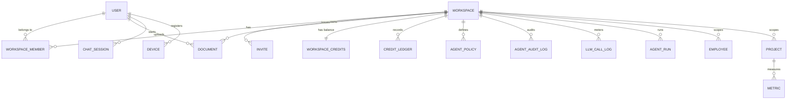

<!-- Sliced from the originating product's shared spec file, keeping only
     audit content. Commit lineage is the original file's; see
     PROVENANCE.md. Generated by notifslice.py -- do not hand-edit. -->

### Credit Balance & Ledger (P)

- Rules: append-only; Redis balance = `SUM(ledger.delta) + grants`; rehydrate-on-cold-start + hourly reconciliation (research §3).

### AI Operation Record / LLM Call Log (P)

- No raw message bodies (FR-024). Drives `llm_cost_daily` materialized view (admin dashboard, FR-022).

### Agent Policy (P)

- `agent_policies`: `id`, `workspace_id`, `agent_role` (`user`|`admin`|`automation`|`integration`), `allowed_tools[]` (MCP tool names), `token_budget_day` INT, `max_loop_depth` INT (default 20), `hooks_enabled[]` (`audit`|`langfuse`|`garak`), `created_at`

### Audit Record (P + K)

- `agent_audit_log` (P): `id`, `workspace_id`, `user_id`, `agent_role`, `tool_called`, `token_cost`, `result_hash` (tamper-evident), `trace_id`, `created_at`. Partitioned by `created_at`.
- `audit_log` (K): generic workspace/member actions — `id`, `workspace_id`, `actor_type`, `actor_id`, `action`, `resource_type`, `resource_id`, `metadata` JSONB, `created_at`. Partitioned by `created_at`.
- Rules: append-only; AI tool calls and workspace/member actions both audited (FR-023).

## Relationships (high level)

## Validation & invariants (test targets)

| Raw prompt/response purged at 30 days | Clarification Q5, FR-024 | Partition drop + PII scrub-before-write |
